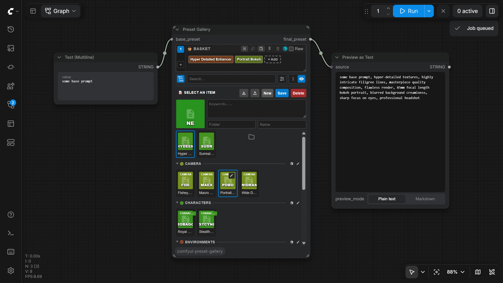

# ComfyUI Preset Gallery

A sleek, visual extension for ComfyUI to save, organize, filter, and reuse your favorite prompt snippets and style templates using an interactive embedded grid.



## 🚀 Quick Start

### 1. Installation

Navigate to your ComfyUI custom nodes directory and clone the repository:

```bash
cd ComfyUI/custom_nodes
git clone https://github.com/j0n4t/comfyui-preset-gallery.git
```

> Sample presets: [presets_sample.yml](./presets_sample.yml)

Restart ComfyUI to load the extension.

### 2. Basic Workflow

1. **Add Node:** Right-click the canvas and select **Add Node → utils › Preset Gallery**.
2. **Connect Output:** Link `final_preset` to a text encoder (e.g., _CLIP Text Encode_). Prepend text by wiring into the optional `base_preset` slot.
3. **Select Items:** Click any grid thumbnail to add it to the **Basket**. Click multiple items to concatenate them into a single prompt sequence.
4. **Queue Prompt:** Run your generation; the combined string is sent right down the pipeline.

## Key Features

### 🧺 Interactive Presets Basket

- **Drag-and-Drop:** Drag presets directly from the grid to arrange, sort, or insert them exactly where you want them inside your basket.
- **Raw Mode & Auto-complete:** Toggle **Raw Mode** to edit your selection as raw comma-separated text. Includes an overlay auto-complete helper with fuzzy search matching and syntax highlighting for better readability.
- **Custom Snippets:** You can add one-time keywords into your selection pool without cluttering your library.

### 🔍 Live Grid Layouts & Filter Search

- **Dynamic Views:** Toggle between small grids, large visual grids, or clean list views instantly.
- **Live Search & Grouping:** Filter presets instantly by keyword, path, or tag. Press **Ctrl+Shift+P** anywhere in ComfyUI to focus the search bar. Keep things organized with subfolder groups.

### ⚙️ Management & Preset Editor

Expand the **⚙️ Management Panel** to curate your collection:

- **Save, Edit, Overwrite:** Create brand‑new items or edit existing items on your grid to update text parameters or subfolders.
- **Image Assets:** Add, replace, or erase reference cover artwork (`.jpg`, `.png`, `.webp`) for any preset entry.
- **Persistence:** Your presets are saved in browser `localStorage`, and you can import and export via `.yaml`, `.json` or `.zip` files.

### 📚 Preset Libraries

One gallery, many collections. `presets.json` next to the extension is the bundled `main` library, and every `.json` file you drop into the `presets/` folder becomes another one — named after its filename, with no registration step. Remove the file and the library goes away.

**⚙️ Settings → Display → Preset Libraries** is a checkbox list of everything the server serves. Every library is in the merge until you switch one off; the choice is global (one merge for the whole instance) and remembered between sessions. The bundled library is always on.

- **Shared names.** A preset name two libraries both have is listed once per library, each tagged with its library. The **first** library in the list wins the plain name — use the ▲ ▼ arrows to set the priority.
- **`library#name` chips.** A chip from a library the merge shadowed keeps its `library#` prefix, so it still expands to that library's copy; a plain name expands to whoever won. **Tag basket chips with their library** (same panel) turns that prefix off, storing every chip as a plain preset name.
- **`library#folder` in the editor.** Typing `sdxl#wear/sock` into **Folder** saves the preset into the `sdxl` library — creating it if it does not exist yet. The same syntax in **Rename Group** moves the whole folder into that library and drops it from the old one.
- **Editing** writes back to the library that owns the key — an edit never leaks from one library's file into another's. Saving over an existing preset always asks first.
- **Emptied libraries go away.** Delete or move the last preset out of a library and it is removed. One left holding only folder colours asks, because those are worth keeping for a library you mean to refill. The bundled `main` library is never removed.

A typical use: one library per base model (anima, SDXL, …), each holding that model's LoRA presets, merged in one node.

A library file is flat JSON in the same shape `presets.json` uses, so a library can also be shared and imported through the normal import button.

### 📐 Display & Panel Sizing

The gallery caps its own viewport instead of growing with your library, so the grid scrolls inside it rather than stretching the node (or the app panel) to the full height of the preset collection. The old manual resize handle is gone — the node's own handle does the work in graph mode.

Open **⚙️ Settings → Display** to choose how tall it should be:

- **Fit to node / panel (default):** follows the node's own size in graph mode and fills the available space in app mode.
- **Fixed height:** pick a pixel height, then pull the gallery's bottom-right corner to adjust it. The value is remembered.
- **Unlimited:** no cap at all — the gallery grows with the whole library.
- **Remember basket and editor sizes:** opt in to keep the basket and editor heights you drag between sessions.
